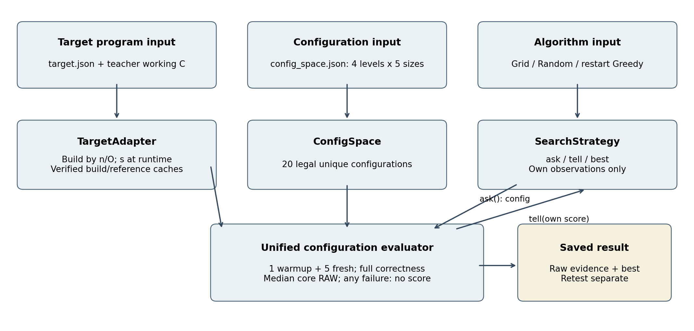
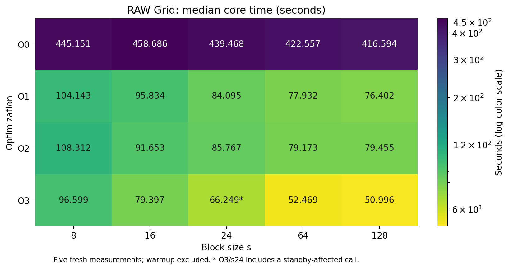
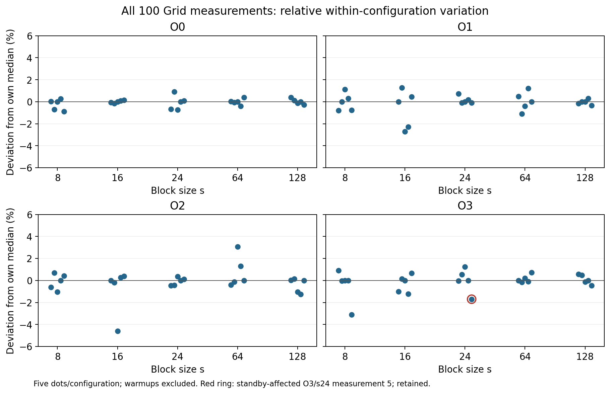

# P1：Matrix Multiplication Autotuner

学号：10245102457<br>
姓名：谷秉仁

## 1. 任务与实验环境

这个调优器为老师提供的矩阵乘法程序选择块大小和编译优化级别。配置空间为
`s ∈ {8,16,24,64,128}` 与 `-O0/-O1/-O2/-O3` 的笛卡尔积，共20种组合。
实现了完整 Grid、无放回 Random 和随机重启 Greedy。完整 RAW Grid 中，
O3/s128 的核心计算中位数最低，为 **50.996291138秒**。两个搜索算法已完成
搜索种子20261008的12配置轨迹及候选独立复测，结论限于这一粒种子。

| 项目 | 实际环境与范围 |
|---|---|
| 操作系统 | Windows 11家庭中文版25H2，WSL2 Ubuntu 24.04 LTS，x86_64 |
| 内核快照 | RAW Grid续跑：6.18.40.1-microsoft-standard-WSL2；<br>10月19日独立验证：6.18.54.1-microsoft-standard-WSL2。实验跨日、跨运行段 |
| CPU | AMD Ryzen 9 7940HX，16物理核、32逻辑线程；目标程序单线程、不绑核，可用CPU为0–31 |
| 内存 | 宿主可见约15.22 GiB，WSL可见约7.36 GiB、swap 2 GiB；不是每次运行的空闲量 |
| 缓存 | WSL的`lscpu`汇总：L1d 512 KiB/16实例、L1i 512 KiB/16实例；<br>L2 16 MiB/16实例、L3 32 MiB/1实例。不是单核独享容量，也不等同于宿主完整拓扑 |
| 编译器 | `/usr/bin/gcc`，GCC 13.3.0（Ubuntu 13.3.0-6ubuntu2~24.04.1） |
| 构建 | C11，`-Wall -Wextra -Wpedantic -Wconversion`，对应`-O0`至`-O3`，`-DMATRIX_N=4096`，链接`-lm`；没有额外`-march=native`或`-ffast-math` |
| 运行与绘图 | WSL Python 3.12.3；离线绘图使用Windows Python 3.12.6、matplotlib 3.10.6 |

环境依据是已有的[CPU/系统采集](evidence/p0/environment_wsl.txt)、
[Grid运行段快照](evidence/p3_raw_grid/20261012-181149-manual-remaining/window/operations/wsl_environment.stdout.txt)、
[后续验证内核记录](evidence/p3_raw_comparison/20261019-122200-user-retry4/operations/environment_kernel.stdout.txt)和
[实际编译器输出](evidence/p3_raw_first_seed/20261019-132400/content/operations/compiler_version.stdout.txt)。
可靠的温度、动态频率、调频策略和硬件性能计数器数据没有取得，下文不据此推断原因。

## 2. 框架设计与重点实现

### 2.1 三个输入接口



图1：目标、配置空间和算法分别输入，统一评估后只向本策略反馈自己的观测。
[SVG版本](images/report_raw_20261021_final/autotuner_framework.svg)。候选复测单独保存，不反馈给搜索。

| 接口 | 实现及职责 |
|---|---|
| 目标程序 | [TargetAdapter](autotuner/core.py)读取[target.json](configs/target.json)，定位工作C、输入头文件、reference生成器和编译器；按尺寸与优化级别构建，`s`作为运行参数 |
| 配置参数组合 | [ConfigSpace](autotuner/core.py)读取[config_space.json](configs/config_space.json)，生成20个合法且唯一的配置，检查范围 |
| 搜索算法 | [SearchStrategy及三个子类](autotuner/search.py)提供`ask/tell/best`；`ask()`提出未评估配置，`tell()`接收对应结果，`best()`从自己的有效观测选最小值 |
| 一次执行 | [Evaluator](autotuner/core.py)执行目标，保存命令、stdout/stderr、退出码、资源和来源，严格解析输出；失败没有分数 |
| 一个配置的评估 | [ConfigurationEvaluator](autotuner/measurement.py)统一完成1次预热、5次fresh测量及统计；外层主控另管准入、资源、连续性与预算 |

配置生成的核心代码如下，优化级别在外层、块大小在内层，也是Grid的固定顺序：

```python
return tuple(
    Config(optimization=optimization, block_size=block)
    for optimization in self.optimization_levels
    for block in self.block_sizes
)
```

策略只接收自身的配置、成功分类和分数。[RAW比较状态机](autotuner/raw_comparison.py)重放旧观测时也走相同接口：

```python
config = strategy.ask()
```

```python
strategy.tell(config, {'classification': group['classification'], 'score_seconds': group['score_seconds']})
```

每个配置只有预热及五次测量全部成功、均为fresh且执行ID唯一时才能计分。
[分组实现](autotuner/measurement.py)从`samples[1:]`取后五次，并使用：

```python
"score_seconds": statistics.median(values) if valid else None,
```

这里分开了目标适配和策略决策，但目标契约仍针对矩阵程序。更换任意其他程序时，
还需要适配参数、结果解析及正确性判据，不是只换文件名就能调优所有目标。
当前RAW Grid与比较使用各自的主控，也没有覆盖全部任务的统一`--algorithm`命令。

### 2.2 老师原件与工作副本

[老师原件](code/original/matrix_multiplication.c)完整保留，SHA-256为
`188d011109c4470e1f41829216e8677a5c2d8f2b7c8a44215652320dbdf6de15`。
[工作副本](code/working/matrix_multiplication.c)保留默认4096、行主序`double`矩阵、
`ih-jh-kh-il-kl-jl`循环次序、尾块边界与`C += A * B`语义：

```c
for (int ih = 0; ih < MATRIX_N; ih += s)
    for (int jh = 0; jh < MATRIX_N; jh += s)
        for (int kh = 0; kh < MATRIX_N; kh += s)
            for (int il = 0; il < s && ih + il < MATRIX_N; ++il)
                for (int kl = 0; kl < s && kh + kl < MATRIX_N; ++kl)
                    for (int jl = 0; jl < s && jh + jl < MATRIX_N; ++jl)
                        C[ih + il][jh + jl] +=
                            A[ih + il][kh + kl] * B[kh + kl][jh + jl];
```

外围增加了固定输入、严格十进制参数解析、RAW整数计时、JSON输出和全矩阵验证。
因此“不改老师原件”不等于“工作副本完全没改”。矩阵输入规则见
[matrix_input.h](code/working/matrix_input.h)，独立参考实现见
[reference_generator.c](code/working/reference_generator.c)。

构建缓存按源码、编译器、完整选项及尺寸区分；每尺寸只需四个优化级别的二进制。
reference缓存与性能样本分开，已核验的构建/reference可复用，正式性能样本不能复用。
优点是三种算法共享正确性和计分规则、策略容易替换、失败可追踪。
代价是适配契约较严格，预热、重复运行、全量校验和检查占用较多时间，
只验证少量元素或只看退出码虽省事，却不能提供同等正确性保证。

## 3. 正确性与测量方法

矩阵尺寸4096，输入模式`random`，矩阵输入种子固定为20261008，生成规则为
`splitmix64-interleaved-v1`。Random/Greedy的**搜索种子**也取20261008，
但它控制配置选择顺序，与控制矩阵数值的输入种子是两个独立参数。

每配置串行执行1次预热和5次独立fresh测量，核心计算时间的后五次中位数为分数。
工作C在乘法前后读取`CLOCK_MONOTONIC_RAW`，先用整数纳秒相减，再转换为秒。
初始化、reference读取、逐元素验证、checksum及JSON输出都在核心计时之外。
输出保留MONOTONIC辅助端点，但不逐样本选择时钟，不按比例校准成绩。

每次计算检查全部`4096²=16,777,216`项。独立非分块`double i-k-j`参考矩阵按
尺寸、种子及生成规则缓存，并用预先固定的16个`long double`点积复核；
这不等于对4096做了全矩阵long double计算。逐元素容差在实验前固定为：

```text
abs(result - reference) <= 1e-12 + 1e-12 * abs(reference)
```

结果、参考、误差、checksum及时间必须有限。运行器还检查退出码0、输出身份、
全部检查项数、容差、RAW主时钟和整数端点一致；任何不满足均无分数。
已有小规模检查覆盖n=129/130、全部20配置、两个随机种子、零矩阵与单位矩阵，
共160例，以及NaN/Inf、错误有限值、非法参数和异常退出等拒绝路径，见
[正确性基础记录](docs/P1_FOUNDATION.md)。这些是已有验证，本次报告整理没有重跑。

三份矩阵约384 MiB是主要数组容量，不是整个系统峰值。参考文件约128 MiB，
校验按行读入；运行时、文件缓存和其他应用另占内存。现行资源v2在组前检查
宿主物理可用及提交余量各至少512 MiB、WSL可用至少2 GiB、根盘至少1 GiB；
宿主低于2 GiB记警告，CPU五次采样平均不超过30%、峰值不超过60%。
这些是背景负载准入条件，不限制目标运行时自身CPU占用；通过不证明无性能干扰。

RAW/QPC有界准入及每组前后检查用于核对跨域时长。搜索另监控待机事件和同范围
QPC/RAW连续性；失败组整体保留、不从成功子集拼分数。明确放弃的部分尝试也保留成本。
候选独立复测不替换搜索分数、不反馈策略。原Grid完成时的检查标准不包含后来新增的
组内连续性保护，因此第4节单独披露它的待机限制。

## 4. 完整RAW Grid结果与性能分析

### 4.1 20配置结果

按O0→O1→O2→O3，每级s=8→16→24→64→128完整遍历。
共20个配置、20次预热、100次测量，均通过原冻结正确性和RAW契约。
下表时间为五次核心计算中位数，单位秒，保留九位小数便于与原数据对应；
位数不代表物理时钟具有纳秒级准确度。

| 优化级别 | s=8 | s=16 | s=24 | s=64 | s=128 |
|---|---:|---:|---:|---:|---:|
| O0 | 445.151418584 | 458.686277198 | 439.467950311 | 422.557072653 | 416.593961898 |
| O1 | 104.142616625 | 95.834183028 | 84.095148938 | 77.932183006 | 76.402275165 |
| O2 | 108.312470579 | 91.653063763 | 85.766510774 | 79.172851750 | 79.455108398 |
| O3 | 96.598588451 | 79.397439353 | 66.249431562* | 52.469094035 | 50.996291138 |



图2：20配置核心时间；格内单位秒，颜色采用对数刻度。数据来自
[完整RAW Grid CSV](evidence/p3_raw_grid/20261012-181149-manual-remaining/grid_summary_20.csv)，
由[原session](evidence/p3_raw_grid/20261011-021601/final-content/grid-f705a488/checkpoint.json)的五次测量复算。
旧MONOTONIC Grid保留在历史材料中，不作为本报告主表，也不与RAW表拼接。

*O3/s24第五次测量期间发生合盖Modern Standby。该次核心RAW为65.122054088秒，
该组六次调用的宿主QPC约2593.845秒、配置评估RAW约417.887秒；组前后检查通过
不能证明组内连续执行。原五个值和66.249431562秒中位数全部保留，没有删样本、
退款或校准。原始事件及绑定见[待机分析](evidence/p3_raw_grid/20261012-181149-manual-remaining/standby_analysis.json)。

### 4.2 从数据解释差异

**固定s看编译优化。** 五列中O0均显著慢于优化版本。例如s128从416.593961898秒
降到O1的76.402275165秒，再到O3的50.996291138秒，O0/O3约8.17倍。
但O2不保证优于O1：s8的108.312470579秒反而比104.142616625秒高约4.00%，
s128的79.455108398秒比76.402275165秒高约4.00%；s16则O2更快。
O3在每列最低，且s64/s128的优势比s8明显，说明优化级别与分块存在交互，不能独立排序。

**固定优化级别看块大小。** O1与O3在这五点上随s增大持续下降：
O1的s8→s128减少约26.64%，O3减少约47.21%。O0的s16比s8更慢，
O2的s128比s64高约0.36%，所以“块越大越好”也不是普遍规律。
O3/s128比O3/s64低约2.81%，这是本表观测差距，不是不同日期都必然成立的常数。

**循环与访存结构。** 内层`jl`沿行主序B、C连续访问，固定的A元素可在一段`jl`中重复使用。
分块把复用限制在较小区域，并减少大跨度访问的活跃数据范围；较大的块还可能摊薄
外层块循环、边界判断和索引计算开销。以三个s×s块粗估活跃数据量，s64约96 KiB，
s128约384 KiB，只是局部工作集估算，不表示恰好落入某级独享缓存。
太大的块可能增加缓存压力，因此这里测到的趋势不能无限外推。

以上结构可以解释“优化后大块通常更快”的可能原因，但本实验没有硬件计数器、
实际向量化诊断或逐项消融，不能断言差异已由缓存命中率、向量化或展开所证明。
O1/O2差异也可能受到代码生成与运行段环境变化共同影响。
4096不能被24整除（余16），其余四种块大小可整除；尾块只是s24的一个因素，
不能把它的全部性能差异、尤其待机影响，都归给尾块。

### 4.3 重复波动与独立验证



图3：100个测量样本，纵轴为相对各配置中位数的偏差；不含预热、不删除慢样本。
红圈标识O3/s24受待机影响的第五次测量。它的RAW偏差不大，仍不能据此认定连续执行。
Grid最低配置的样本CV为0.4313%、MAD为0.229528039秒。
CV采用五次样本的样本标准差/均值，MAD为`median(|x−median(x)|)`，下文均沿用此定义。

独立验证按O3/s128→s64→s24执行，每组仍为1+5fresh，全矩阵校验：

| 配置 | 原Grid中位数(s) | 独立验证中位数(s) | 变化 | 验证CV | 验证MAD(s) |
|---|---:|---:|---:|---:|---:|
| O3/s128 | 50.996291138 | 51.602724641 | +1.1892% | 1.7022% | 0.449608174 |
| O3/s64 | 52.469094035 | 52.784908609 | +0.6019% | 1.7756% | 0.242572761 |
| O3/s24 | 66.249431562 | 63.240102045 | −4.5424% | 0.5041% | 0.273363999 |

数据见[独立验证CSV](evidence/p3_raw_comparison/20261019-122200-user-retry4/three_configuration_comparison.csv)。
18次执行均通过正确性、RAW和新连续性检查；前两组在10月14日，s24在19日，
不是严格同环境连续对照。验证支持这三点的相同排序，但不替换Grid、不追认原s24连续，
更不取两轮较小值作为新成绩。

## 5. Random与Greedy设计及过程

Random对20个配置做种子化Fisher–Yates排列，按排列无放回取前12个。
Greedy从未评估配置随机选起点；邻域只改变一个参数到任意其他合法值，
即3个优化级别邻居加4个块大小邻居，共7个。它将当前点尚未观测的邻居洗牌后依次评估，
再从七邻居中选择严格改善的最佳点；若没有改善，则从未评估配置随机重启。
已观测邻居参与选择但不重复占预算，预算耗尽即返回截至当时的最好有效观测。

两策略只使用自己的观测。Grid、独立验证、另一算法及候选复测均不作为决策输入。
具体实现见[search.py](autotuner/search.py)；下表来自终态轨迹，时间单位秒：

| 次序 | Random配置 | 核心中位数 | Greedy配置 | 核心中位数 |
|---|---|---:|---|---:|
| 1 | O1/s64 | 77.616996424 | O1/s128 | 74.902692785 |
| 2 | O0/s24 | 430.327255710 | O1/s16 | 94.989367418 |
| 3 | O3/s16 | 78.293705820 | O3/s128 | 51.760896392 |
| 4 | O0/s8 | 447.926317490 | O2/s128 | 77.489962690 |
| 5 | O3/s128 | 50.535368854 | O1/s64 | 77.157359678 |
| 6 | O1/s8 | 103.050748766 | O1/s8 | 102.736630893 |
| 7 | O2/s8 | 106.707298350 | O1/s24 | 85.144080766 |
| 8 | O2/s64 | 76.614226846 | O0/s128 | 412.443699526 |
| 9 | O1/s16 | 93.539787600 | O3/s24 | 64.579616031 |
| 10 | O2/s24 | 84.650723547 | O3/s8 | 96.227240746 |
| 11 | O3/s24 | 64.867244244 | O3/s64 | 54.956165833 |
| 12 | O0/s64 | 421.138291769 | O3/s16 | 76.030582031 |

Greedy第3点已访问O3/s128，前四点评估后选中它；Random第5点才访问该配置，
所以B4仍选O1/s64，到B8选O3/s128。Greedy先评估完起点的七邻居，
之后转向更优的O3/s128，继续评估其未见邻居；并非看到一个好邻居就立即跳转。

B=4/8/12是**同一条12评估轨迹的前缀**，不是各重跑一条。
Random的三个前缀有两个不同候选，独立复测2组；Greedy只有一个，独立复测1组。
跨算法即便候选同为O3/s128，也不共享性能样本，复测不改变原轨迹。

## 6. 三算法比较与优劣

### 6.1 相同评估口径

| 算法 | 唯一配置评估/覆盖率 | 选中配置 | 自身原始中位数(s) | 独立验证或复测中位数(s) | 已接纳配置评估RAW(s) |
|---|---|---|---:|---:|---:|
| Grid | 20/20，100% | O3/s128 | 50.996291138 | 51.602724641（第4.3节独立验证） | 20707.004089023 |
| Random，B12 | 12/20，60% | O3/s128 | 50.535368854 | 51.118067107（Random自己的复测） | 12370.681806653 |
| Greedy，B12 | 12/20，60% | O3/s128 | 51.760896392 | 50.118510833（Greedy自己的复测） | 7753.893434528 |

Grid是该有限空间的完整实测参照，不是没有噪声的真实全局最优。
三个算法最终选中相同参数，分数来自不同运行段，不能因Greedy复测更小就解释为
“Greedy让同一矩阵配置计算得更快”。本报告不展示固定Grid顺序的短前缀，
避免把先遍历较慢O0的顺序偏置与有限预算搜索混为一谈。

### 6.2 六行前缀结果

时间和MAD单位秒；CV为百分数。`搜/复`分别表示所选候选自身的五次搜索测量和
五次独立复测，不是跨搜索种子的波动。相同算法的同一候选复测去重，所以部分行重复。

| 算法 | B/已评估数 | 选中配置 | 搜索中位数 | 独立复测中位数 | CV：搜/复(%) | MAD：搜/复(s) | 配置评估RAW(s) |
|---|---:|---|---:|---:|---:|---:|---:|
| Random | 4/4 | O1/s64 | 77.616996424 | 77.570096137 | 0.5364 / 0.6140 | 0.246258124 / 0.208011120 | 6273.335551774 |
| Random | 8/8 | O3/s128 | 50.535368854 | 51.118067107 | 2.5557 / 0.7426 | 0.408699577 / 0.192439805 | 8340.945843372 |
| Random | 12/12 | O3/s128 | 50.535368854 | 51.118067107 | 2.5557 / 0.7426 | 0.408699577 / 0.192439805 | 12370.681806653 |
| Greedy | 4/4 | O3/s128 | 51.760896392 | 50.118510833 | 0.4729 / 0.5382 | 0.176828183 / 0.127395643 | 1839.423685402 |
| Greedy | 8/8 | O3/s128 | 51.760896392 | 50.118510833 | 0.4729 / 0.5382 | 0.176828183 / 0.127395643 | 5960.500095546 |
| Greedy | 12/12 | O3/s128 | 51.760896392 | 50.118510833 | 0.4729 / 0.5382 | 0.176828183 / 0.127395643 | 7753.893434528 |

六行来源为[首种子CSV](evidence/p3_raw_first_seed/20261020-214028-09795d71-first-seed-finish/first_seed_six_rows.csv)，
轨迹及复测组来自[终态检查点](evidence/p3_raw_first_seed/20261019-132400/content/search-c1bd157c/checkpoint.json)。
独立复测相对自身搜索中位数：Random O1/s64为−0.0604%、O3/s128为+1.1531%，
Greedy O3/s128为−3.1730%。这些变化提醒我，即便候选相同，运行段和采样波动仍需披露。

### 6.3 成本范围与算法取舍

核心RAW只用于分数；配置评估RAW包含预热、五次fresh及评估过程的验证、缓存查找和落盘，
不含组前门禁、准入、共享准备、放弃尝试及候选复测。上两表使用这个相同的局部成本口径。
Greedy B12比Random B12低约37.32%。本次Random评估了3个O0配置、Greedy只有1个，
配置组成是这项成本差异的重要因素；
**不等于端到端提速37.32%**，也不是多种子的平均优势。

| 成本项 | 数值与包含关系 |
|---|---|
| Random独立复测RAW | 791.041269405秒，两组；不占12配置搜索预算 |
| Greedy独立复测RAW | 311.761200991秒，一组；不借用Random复测 |
| 首种子各段共享准备QPC | 84.7506965、78.7235807、88.3884232秒；分别含各段准入/核验等，已包含在活动包络中 |
| 首种子活动QPC | 三个独立窗口15841.5879168 + 7488.0732714 + 962.6504186 = **24292.3116068秒**，总预算43200秒；包含门禁、等待、失败、目标、复测和收尾 |
| 完整端到端前缀成本 | 未知；不能把最后整个活动包络按比例分给B4/B8/B12 |

活动QPC、配置评估RAW、目标核心RAW、准备和复测有嵌套关系，不能全部相加。
审核期间未运行的暂停不算活动执行，历史待机和失败没有退款，余额没有启动新实验。
Grid宿主包络含待机，不拿它直接证明Random或Greedy端到端更快。
详细范围留在[首种子成本记录](evidence/p3_raw_first_seed/20261020-214028-09795d71-first-seed-finish/costs.json)，
旧前缀字段的限制见[成本口径说明](docs/P3_COST_SCOPE.md)。

| 算法 | 优点 | 代价与局限 |
|---|---|---|
| Grid | 覆盖完整，能找出本次20配置表的实测最低值，便于观察交互 | 评估开销大；固定顺序的短前缀有偏置，观测仍受噪声和中断影响 |
| Random | 简单、无重复，不依赖局部邻域结构 | 小预算是否抽到好点取决于种子；本次B4尚未找到O3/s128 |
| Greedy | 利用已观测邻域与严格改善，本次B4已选中O3/s128且局部评估成本较低 | 依赖起点、邻域和局部选择；扫描七邻居本身有开销，重启也不保证小预算找到最好点 |

这些实验说明三种策略在该空间中的不同取舍，不能由一粒种子得出Greedy普遍优于Random。

## 7. 总结与简明复现

完成调优器后，我发现最难的部分不只是“选择下一个配置”，而是让不同策略拿到
可比较的观测：输入相同、计算完整、失败无分数、重复次数相同、复测与搜索分离。
分离三个接口后，搜索代码很短，更多工作落在目标适配、正确性和测量上。
完整校验和1+5重复增加了成本，却让我能区别参数选择的收益与测量本身的波动。

本次RAW Grid最低配置为O3/s128，Random与Greedy最终也选中它；Greedy在这粒种子的
B4更早选到，Random到B8选到。编译优化的作用比本表多数块大小间差异大，
但O1/O2和O2的s64/s128说明优化级别、块大小都不能简单按数值大小排序。
我能用访存和循环开销解释趋势，但没有把未经计数器或消融证实的解释当成事实。

结果仍有边界：只完成一个搜索种子；实验跨日、分段；原Grid s24有待机，搜索也保留
两次受扰尝试共6条放弃记录。首种子共有24搜索组、3复测组，162条已接纳执行，
加6条放弃记录为168条唯一执行。低宿主内存警告仍保留：33份准入/门禁快照中20份
有警告，最低宿主可用约679 MiB；这不是全运行期间的最小值，更不证明无资源压力。
原计划的五粒种子20261008–20261012是真实的后续计划，目前仅完成首粒，
五种子整体完成与比较状态仍为false。课程要求的三种算法及结果比较，与该自定扩展计划分别说明。

正式提交为`project01`分支，本文件是唯一课程报告。代码在`autotuner/`、`code/working/`、
`scripts/`，老师原件在`code/original/`。查看接口/配置无需启动实验：

```bash
python3 -m autotuner --help
python3 -m autotuner list-configs
```

下列命令只读归档数据并向**全新目录**写派生统计，不调用目标、门禁、时钟探针或一次性claim。
不绘图时仅需Python标准库；加`--figures`需matplotlib：

```bash
python3 scripts/report_offline.py --output /tmp/project01-report-review-unique
```

输出目录已存在会拒绝覆盖，换一个新名字即可。已有[离线复算与图表数据](evidence/report_release/20261021/derived-release/summary.json)
记录原始输入SHA-256及校验结果。本次报告整理新增真实性能执行为0。

真实RAW比较入口是Windows的[prepare_raw_comparison.py](scripts/prepare_raw_comparison.py)
（导出内容、核验并初始化空session）和[start_raw_comparison.py](scripts/start_raw_comparison.py)
（带匹配计划/授权的真实长跑），其WSL测量模块是[autotuner.raw_comparison](autotuner/raw_comparison.py)。
旧`python -m autotuner campaign`不支持当前RAW比较，不能用于复现本结果；
关闭的Grid和首种子session、已领取claim不得直接再启动。完整运行身份和历史失败只在
[交接入口](docs/AUDIT_HANDOFF.md)保留，不把它们混入新的实验或修改成绩。
